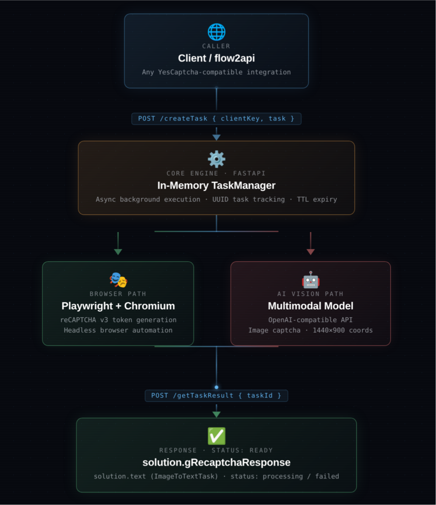

<p align="center">
  
  <br/>
  
  
  
  
  
  
</p>

<h1 align="center">🧩 OhMyCaptcha</h1>

<p align="center">
  <strong>面向 <a href="https://github.com/OpenClaw/openclaw">flow2api</a> 与类似集成场景的可自托管 YesCaptcha 风格验证码服务</strong>
  <br/>
  <em>19 种任务类型 · reCAPTCHA v2/v3 · hCaptcha · Cloudflare Turnstile · 图像分类</em>
</p>

<p align="center">
  <a href="#-快速开始">快速开始</a> •
  <a href="#-架构">架构</a> •
  <a href="#-任务类型">任务类型</a> •
  <a href="#-部署">部署</a> •
  <a href="#-开发">开发</a>
</p>

<p align="center">
  <a href="README.md">English README</a> •
  <a href="https://shenhao-stu.github.io/ohmycaptcha/">在线文档</a> •
  <a href="https://shenhao-stu.github.io/ohmycaptcha/zh/deployment/render/">Render 部署指南</a> •
  <a href="https://shenhao-stu.github.io/ohmycaptcha/zh/deployment/huggingface/">Hugging Face Spaces 指南</a>
</p>

<p align="center">
  
</p>

---

## ✨ 这是什么？

**OhMyCaptcha** 是一个可直接部署的自托管验证码解决服务，提供 **YesCaptcha 风格异步 API**，支持 **19 种任务类型**。作为第三方打码工具，专为 **flow2api** 及依赖 `createTask` / `getTaskResult` 语义的系统设计。

| 能力 | 详情 |
|------|------|
| **浏览器自动化** | Playwright + Chromium 实现 reCAPTCHA v2/v3、hCaptcha、Cloudflare Turnstile 自动求解 |
| **图片识别** | 本地多模态模型（通过 SGLang 部署 Qwen3.5-2B）进行图片验证码分析 |
| **图像分类** | 本地视觉模型进行 HCaptcha、reCAPTCHA v2、FunCaptcha、AWS 网格分类 |
| **API 兼容** | 完整的 YesCaptcha `createTask`/`getTaskResult`/`getBalance` 协议 |
| **部署方式** | 支持本地、Render、Hugging Face Spaces 的 Docker 部署 |

---

## 📦 快速开始

```bash
python -m venv .venv && source .venv/bin/activate
pip install -r requirements.txt
playwright install --with-deps chromium

# 本地模型（通过 SGLang 自托管部署）
export LOCAL_BASE_URL="http://localhost:30000/v1"
export LOCAL_MODEL="Qwen/Qwen3.5-2B"

# 云端模型（远程 API）
export CLOUD_BASE_URL="https://your-openai-compatible-endpoint/v1"
export CLOUD_API_KEY="your-api-key"
export CLOUD_MODEL="gpt-5.4"

# 可选：让浏览器类 solver 通过代理出网
export BROWSER_PROXY_SERVER="socks5://127.0.0.1:7890"

export CLIENT_KEY="your-client-key"
python main.py
```

验证服务：

```bash
curl http://localhost:8000/api/v1/health
```

---

## 🏗 架构

<p align="center">
  
</p>

**核心组件：**

- **FastAPI** — 实现 YesCaptcha 协议的 HTTP API
- **TaskManager** — 异步内存任务队列，10 分钟 TTL
- **RecaptchaV3Solver** — 基于 Playwright 的 reCAPTCHA v3/Enterprise 令牌生成
- **RecaptchaV2Solver** — 基于 Playwright 的 reCAPTCHA v2 复选框求解
- **HCaptchaSolver** — 基于 Playwright 的 hCaptcha 求解
- **TurnstileSolver** — 基于 Playwright 的 Cloudflare Turnstile 求解
- **CaptchaRecognizer** — 受 Argus 启发的多模态图片分析
- **ClassificationSolver** — 基于视觉模型的图像分类

---

## 🧠 任务类型

### 浏览器自动化求解（12 种）

| 分类 | 任务类型 | 返回字段 |
|------|---------|---------|
| reCAPTCHA v3 | `RecaptchaV3TaskProxyless`, `RecaptchaV3TaskProxylessM1`, `RecaptchaV3TaskProxylessM1S7`, `RecaptchaV3TaskProxylessM1S9` | `gRecaptchaResponse` |
| reCAPTCHA v3 企业版 | `RecaptchaV3EnterpriseTask`, `RecaptchaV3EnterpriseTaskM1` | `gRecaptchaResponse` |
| reCAPTCHA v2 | `NoCaptchaTaskProxyless`, `RecaptchaV2TaskProxyless`, `RecaptchaV2EnterpriseTaskProxyless` | `gRecaptchaResponse` |
| hCaptcha | `HCaptchaTaskProxyless` | `gRecaptchaResponse` |
| Cloudflare Turnstile | `TurnstileTaskProxyless`, `TurnstileTaskProxylessM1` | `token` |

### 图片识别（3 种）

| 任务类型 | 返回字段 |
|---------|---------|
| `ImageToTextTask` | `text`（结构化 JSON） |
| `ImageToTextTaskMuggle` | `text` |
| `ImageToTextTaskM1` | `text` |

### 图像分类（4 种）

| 任务类型 | 返回字段 |
|---------|---------|
| `HCaptchaClassification` | `objects` / `answer` |
| `ReCaptchaV2Classification` | `objects` |
| `FunCaptchaClassification` | `objects` |
| `AwsClassification` | `objects` |

---

## 🔌 API 接口

| 接口 | 作用 |
|------|------|
| `POST /createTask` | 创建异步验证码任务 |
| `POST /getTaskResult` | 轮询任务执行结果 |
| `POST /getBalance` | 返回兼容性余额 |
| `GET /api/v1/health` | 健康状态检查 |

### 示例：reCAPTCHA v3

```bash
curl -X POST http://localhost:8000/createTask \
  -H "Content-Type: application/json" \
  -d '{
    "clientKey": "your-client-key",
    "task": {
      "type": "RecaptchaV3TaskProxyless",
      "websiteURL": "https://antcpt.com/score_detector/",
      "websiteKey": "6LcR_okUAAAAAPYrPe-HK_0RULO1aZM15ENyM-Mf",
      "pageAction": "homepage"
    }
  }'
```

### 示例：hCaptcha

```bash
curl -X POST http://localhost:8000/createTask \
  -H "Content-Type: application/json" \
  -d '{
    "clientKey": "your-client-key",
    "task": {
      "type": "HCaptchaTaskProxyless",
      "websiteURL": "https://example.com",
      "websiteKey": "hcaptcha-site-key"
    }
  }'
```

### 示例：Cloudflare Turnstile

```bash
curl -X POST http://localhost:8000/createTask \
  -H "Content-Type: application/json" \
  -d '{
    "clientKey": "your-client-key",
    "task": {
      "type": "TurnstileTaskProxyless",
      "websiteURL": "https://example.com",
      "websiteKey": "turnstile-site-key"
    }
  }'
```

### 示例：图像分类

```bash
curl -X POST http://localhost:8000/createTask \
  -H "Content-Type: application/json" \
  -d '{
    "clientKey": "your-client-key",
    "task": {
      "type": "ReCaptchaV2Classification",
      "image": "<base64-encoded-image>",
      "question": "Select all images with traffic lights"
    }
  }'
```

### 轮询结果

```bash
curl -X POST http://localhost:8000/getTaskResult \
  -H "Content-Type: application/json" \
  -d '{"clientKey": "your-client-key", "taskId": "uuid-from-createTask"}'
```

---

## ⚙️ 配置项

### 模型后端

OhMyCaptcha 使用两种模型后端 —— **本地模型**处理图像任务，**云端模型**处理复杂推理：

| 变量 | 说明 | 默认值 |
|------|------|--------|
| `LOCAL_BASE_URL` | 本地推理服务地址（SGLang/vLLM） | `http://localhost:30000/v1` |
| `LOCAL_API_KEY` | 本地服务密钥 | `EMPTY` |
| `LOCAL_MODEL` | 本地模型名称 | `Qwen/Qwen3.5-2B` |
| `CLOUD_BASE_URL` | 云端 API 基地址 | 外部端点 |
| `CLOUD_API_KEY` | 云端 API 密钥 | 未设置 |
| `CLOUD_MODEL` | 云端模型名称 | `gpt-5.4` |

### 通用

| 变量 | 说明 | 默认值 |
|------|------|--------|
| `CLIENT_KEY` | 客户端认证密钥 | 未设置 |
| `CAPTCHA_RETRIES` | 重试次数 | `3` |
| `CAPTCHA_TIMEOUT` | 模型请求超时（秒） | `30` |
| `BROWSER_HEADLESS` | 无头浏览器 | `true` |
| `BROWSER_TIMEOUT` | 页面加载超时（秒） | `30` |
| `BROWSER_PROXY_SERVER` | Playwright 浏览器显式代理（`socks5://...`、`http://...`） | 未设置 |
| `SERVER_HOST` | 监听地址 | `0.0.0.0` |
| `SERVER_PORT` | 监听端口 | `8000` |

> 旧版变量（`CAPTCHA_BASE_URL`、`CAPTCHA_API_KEY`、`CAPTCHA_MODEL`、`CAPTCHA_MULTIMODAL_MODEL`）仍支持作为回退。
> 浏览器代理回退顺序：`BROWSER_PROXY_SERVER` → `ALL_PROXY` → `HTTPS_PROXY` → `HTTP_PROXY`。

---

## 🚀 部署

- [本地模型 (SGLang)](https://shenhao-stu.github.io/ohmycaptcha/zh/deployment/local-model/) — 本地部署 Qwen3.5-2B
- [Render 部署](https://shenhao-stu.github.io/ohmycaptcha/zh/deployment/render/)
- [Hugging Face Spaces 部署](https://shenhao-stu.github.io/ohmycaptcha/zh/deployment/huggingface/)
- [完整文档](https://shenhao-stu.github.io/ohmycaptcha/)

---

## ✅ 测试目标

本服务针对以下公开 reCAPTCHA v3 检测目标完成验证：

- URL：`https://antcpt.com/score_detector/`
- Site key：`6LcR_okUAAAAAPYrPe-HK_0RULO1aZM15ENyM-Mf`

---

## ⚠️ 限制说明

- 任务状态保存在**内存中**，TTL 为 10 分钟
- `minScore` 为兼容性字段，当前不做分数控制
- 浏览器自动化的稳定性取决于运行环境、IP 信誉和目标站行为
- 图像分类质量取决于所使用的视觉模型
- 并非所有商业打码平台功能均已复现

---

## 📢 免责声明

> **本项目仅供合法的安全研究、渗透测试和技术学习使用。**

- OhMyCaptcha 是一个可自托管的工具。你对自己的部署方式和使用行为负完全责任。
- CAPTCHA 系统的存在是为了保护服务免受滥用。**未经目标网站或服务所有者明确授权，请勿使用本工具绕过 CAPTCHA。**
- 未经授权地对第三方服务进行自动化访问，可能违反其服务条款，并可能在相关法律管辖区（如《计算机欺诈与滥用法》、GDPR 或当地等效法规）下构成违法行为。
- 本项目的作者和贡献者**不承担任何因使用本软件而导致的滥用行为、法律后果或损失的责任**。
- 使用本软件即表示你同意自行确保其使用方式符合所有相关法律法规及服务条款。

---

## 🔧 开发

```bash
pytest tests/
npx pyright
python -m mkdocs build --strict
```

---

## Star History

[](https://www.star-history.com/#shenhao-stu/ohmycaptcha&Date)

---

## 📄 License

[MIT](LICENSE) —— 自由使用，开放修改，谨慎部署。

完整使用条款与免责声明请参阅 [DISCLAIMER.zh-CN.md](DISCLAIMER.zh-CN.md)。
